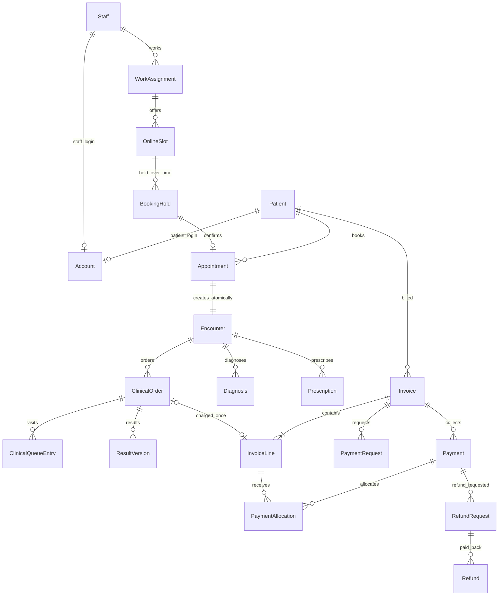
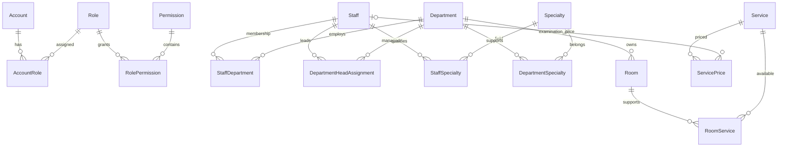
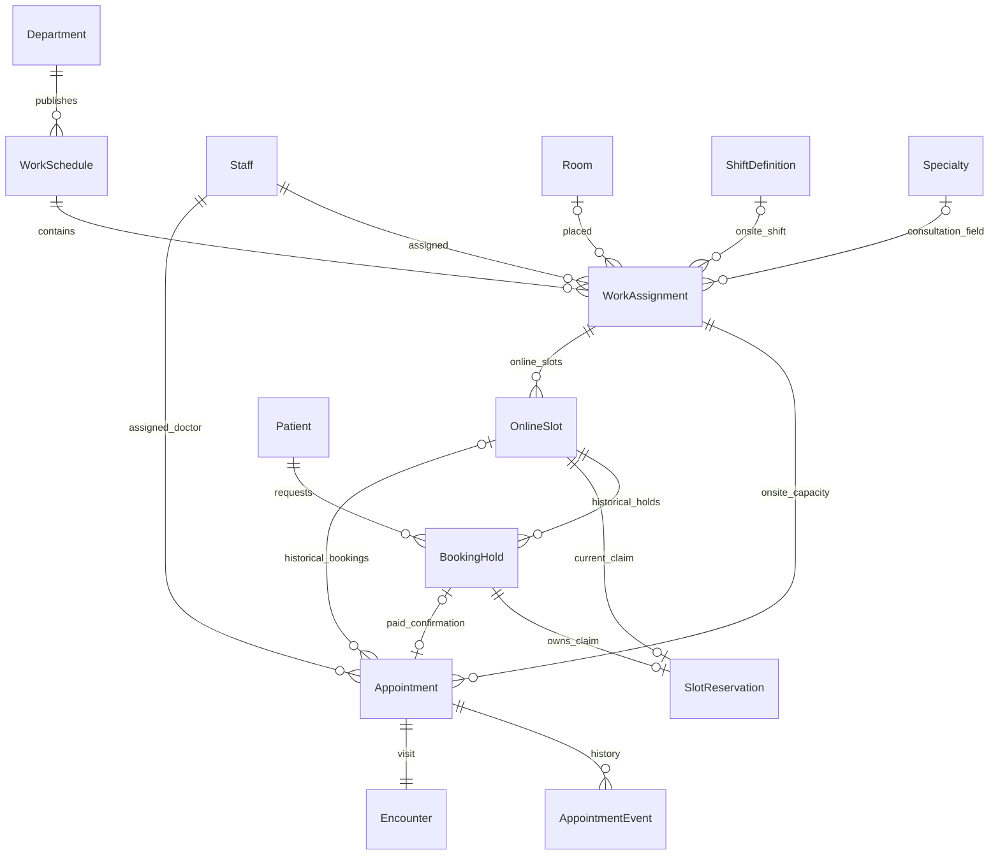
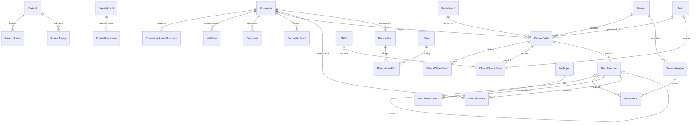
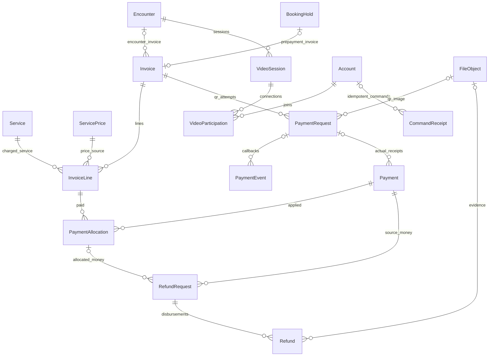

# 02 — ERD và quan hệ

Sơ đồ logic dùng Mermaid. Các bảng nối và quan hệ chỉ xuất hiện ở sơ đồ module để sơ đồ tổng thể đọc được. Danh sách cột đầy đủ ở tài liệu 03.

## Tổng thể

Account–Patient và Account–Staff là **XOR**, không phải Account được liên kết đồng thời cả hai. Invoice DRAFT có thể chưa có line; khi ISSUED phải có ít nhất một line. ClinicalOrder có đúng một InvoiceLine khi hóa đơn được phát hành; trước đó có thể chưa có.

## Tổ chức và phân quyền

## Phân lịch và đặt khám

WorkAssignment → Appointment chỉ dùng cho trực tiếp. Mỗi Appointment online thuộc đúng một slot; slot có thể có nhiều Appointment **lịch sử đã hủy**, tối đa một Appointment không hủy. SlotReservation giữ quyền chiếm độc quyền cho hold ACTIVE hoặc CONFIRMED. Hết hạn không xóa BookingHold, chỉ giải phóng reservation.

## Khám, CLS và kê đơn

Draft Prescription có thể rỗng, ISSUED phải có line. Chuỗi đính chính tuyến tính: một published version có tối đa một successor; successor nháp không thay current published version. Snapshot ghi nhận tiền sử, thuốc, chỉ số và giá để không phụ thuộc danh mục tương lai.

## Thanh toán và vận hành

Invoice dùng Encounter **hoặc** BookingHold, không cả hai. Hóa đơn online luôn giữ hold_id kể cả sau khi có Encounter; báo cáo truy ngược qua Appointment.hold_id. Không sửa FK hóa đơn sau phát hành.

Các FK actor tới Account và bảng SystemSetting/AuditEvent không vẽ hết để tránh che luồng nghiệp vụ. Chúng được định nghĩa ở tài liệu 03.
